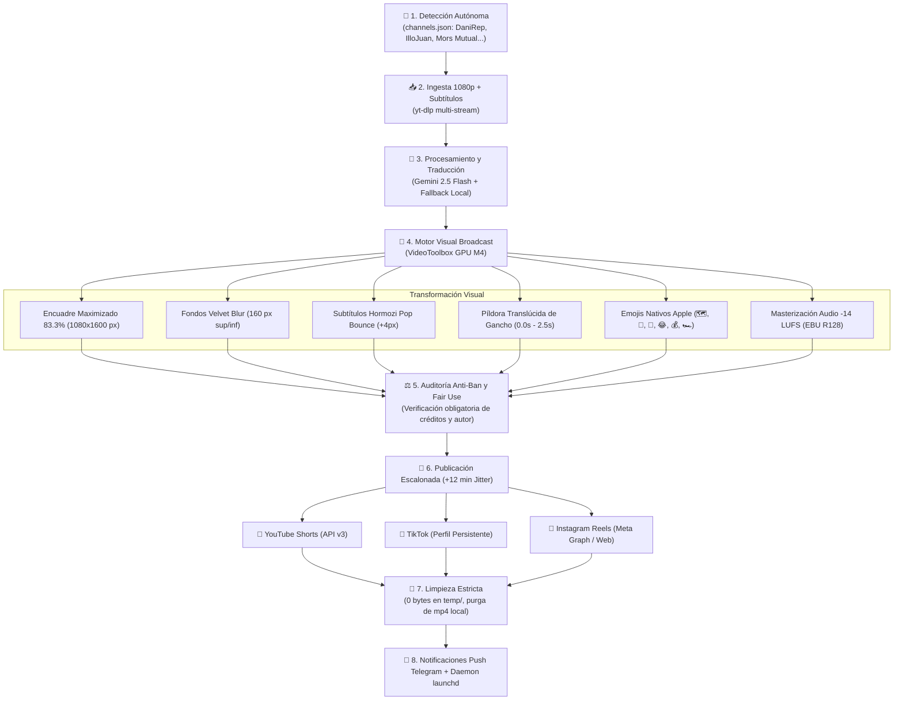

<p align="center">
  
</p>

<p align="center">
  
  
  
  
  
</p>

# 🎮 GTA VI Hub Spain — Autonomous Content Engine (macOS)

Pipeline de producción y distribución audiovisual 100% autónomo para **YouTube Shorts, TikTok e Instagram Reels**, optimizado para ejecutarse silenciosamente en segundo plano 24/7 en macOS (**Apple Silicon M1/M2/M3/M4 o Intel**) con aceleración por hardware nativa (`h264_videotoolbox`) y control remoto bidireccional vía **Telegram Bot**.

---

### 🌐 Canales, Redes Sociales y Bot Oficiales

| Plataforma | Canal / Bot Oficial | Identidad Visual | Estado |
| :--- | :--- | :---: | :---: |
| 🔴 **YouTube Shorts** | [**GTA VI Hub Spain**](https://www.youtube.com/channel/UCBOl2KuaHEoUWYWJqb7ID9Q) | Avatar Neón + Portada 4K | **Conectado (OAuth2 API v3)** |
| 📸 **Instagram Reels** | [**@gtavihubspain**](https://www.instagram.com/gtavihubspain/) | Avatar Neón + Bio Oficial | **Activo y Verificado** |
| 🎵 **TikTok** | [**@gtavihubspain**](https://www.tiktok.com/@gtavihubspain) | Avatar Neón + Bio Oficial | **Activo y Verificado** |
| 🤖 **Telegram Bot** | [**@gtavihub_spain_bot**](https://t.me/gtavihub_spain_bot) | GTA VI Hub Monitor | **Activo 24/7 (Daemon launchd)** |

---

## 🏗️ Arquitectura del Sistema



---

## ⚡ Estándares Broadcast y Retención Móvil

1. **Reencuadre Cinematográfico al 83.3% (`1080x1600 px`):**
   * El clip horizontal 16:9 se amplía recortando laterales para centrar al streamer o la jugabilidad.
   * Franjas superior e inferior con desenfoque aterciopelado (*velvet blur*) de solo 160 px, integradas con sombras de profundidad multinivel.
2. **Subtítulos Dinámicos Alex Hormozi (Pop Bounce):**
   * La palabra activa **aumenta de escala dinámicamente (`+4px`)**, iluminándose en amarillo eléctrico o rosa neón con halo de lectura.
   * Filtro de *rolling buffer* para evitar solapamientos y anclaje en `y=1280` (zona segura sobre los botones de TikTok/Reels).
3. **Audio Ducking Dinámico Inteligente (`sidechaincompress`):**
   * El sonido original del juego se comprime dinámicamente a ~18% solo mientras el locutor habla, recuperando automáticamente el 100% de fuerza sonora en silencios, efectos y disparos.
   * Normalización formal EBU R128 (`-14 LUFS`) para presencia equilibrada en altavoces de smartphone.
4. **Detector de Picos Virales en Directos Largos (*Heatmap Slicer*):**
   * Analiza el mapa de calor de YouTube (*most replayed*) de vídeos largos (>85s) para recortar automáticamente la ventana de 45-55 segundos de máxima retención, resincronizando los subtítulos.
5. **Centro de Control Móvil Interactivo vía Telegram (`src/telegram_bot.py`):**
   * **Teclado Táctil Persistente:** Acceso con 1 toque a `[🚀 Forzar Escaneo]`, `[📊 Dashboard]`, `[🎬 Último Clip]`, `[🖥️ Estado Host / GaTDSEQ]`, `[📈 Métricas YouTube]`, `[⚙️ Canales]`, `[🛡️ Modo Co-Pilot]`, `[🧹 Limpiar Temp]`.
   * **Ingesta Bajo Demanda de Enlaces:** Pega cualquier enlace de YouTube o TikTok en el chat; el bot extraerá la miniatura y ofrecerá botones de formato instantáneos (`⚡ Short Hormozi`, `🎙️ Doblaje Neural`, `💬 Subtítulos`).
   * **Modo Co-Pilot (Puerta de Enlace Humana):** Pausa la publicación y envía una vista previa a Telegram con botones interactivos `[✅ Aprobar y Publicar]` y `[❌ Descartar y Purgar]`.
   * **Telemetría de Hardware y GaTDSEQ (`/host`):** Monitorea CPU load, RAM real macOS, SSD, batería y convivencia cuantitativa.
   * **Analíticas en Vivo de YouTube (`/stats`):** Muestra suscriptores, visualizaciones totales y rendimiento de subidas recientes vía API v3.
   * **Gestión Dinámica de Canales (`/channels`):** Activa, desactiva o añade fuentes (`/addchannel`) directamente desde el chat.

---

## 🛡️ Protocolo de Coexistencia de Hardware (GaTDSEQ & Cargas Cuantitativas)

Diseñado para convivir pacíficamente en el mismo host headless (**MacBook Pro**) junto a procesos de cálculo intensivo, machine learning y backtesting de **GaTDSEQ** (`optimize_fleet.py`, `run_backtest.py`, `xgboost_gate.py`) sin sobrecalentar el procesador ni degradar las estrategias cuantitativas:

1. **Aislamiento y Prioridad de CPU (`Nice 15` / QoS Background):**
   * Los demonios `launchd` operan con `<key>Nice</key><integer>15</integer>` y `<key>ProcessType</key><string>Background</string>`. 
   * El kernel Darwin (macOS) prioriza siempre a GaTDSEQ para ciclos de CPU, relegando a GTA VI Hub a los tiempos desocupados.
2. **Prioridad I/O Reducida en Disco (`LowPriorityIO`):**
   * Ambos servicios operan con `<key>LowPriorityIO</key><true/>`, impidiendo que las lecturas y escrituras de vídeo generen retrasos de entrada/salida en los datasets y logs de GaTDSEQ.
3. **Límite Estricto de Hilos de CPU (`FFmpeg Thread-Capping`):**
   * En reposo del quant, FFmpeg se limita a **2 hilos** (de los 4 lógicos del Core i5), garantizando al menos 2 núcleos libres permanentemente.
   * **Modo Cortesía Activo:** Si el sistema detecta que GaTDSEQ está ejecutando una optimización o backtest (`is_quant_busy()`), FFmpeg reduce automáticamente su consumo a **1 solo hilo**.
4. **Codificación por Hardware en GPU (`h264_videotoolbox`):**
   * El renderizado H.264 se descarga directamente al chip ASIC de la GPU (QuickSync/VideoToolbox), aliviando la carga de la CPU y reduciendo el calor y los ventiladores.
5. **Huella de Memoria Minimizada (~70 MB):**
   * El bot de Telegram consume solo el **0.9% de RAM** en reposo. Al concluir un vídeo, el recolector de basura de Python libera la memoria inmediatamente para los DataFrames de GaTDSEQ.

---

## 🚀 Guía de Comandos Rápidos (`run.sh`)

```bash
# 1. Panel de control y monitorización en tiempo real
./run.sh status

# 2. Iniciar el bot de control remoto y notificaciones de Telegram
./run.sh telegram

# 3. Auditar cumplimiento de políticas de YouTube, TikTok y Meta
./run.sh audit

# 4. Simular publicación completa multiplataforma (Sandbox seguro)
./run.sh --url "<ENLACE_YOUTUBE>" --publish-all --dry-run

# 5. Procesar un vídeo y abrirlo inmediatamente en QuickTime Player
./run.sh --url "<ENLACE_YOUTUBE>" --preview

# 6. Ejecutar escaneo autónomo de canales (channels.json)
./run.sh --auto

# 7. Forzar purga y limpieza de residuos en disco
./run.sh --clean
```

---

## 🖥️ Operación Desatendida 24/7 en macOS (`launchd`)

Para dejar el motor funcionando de forma continua en tu **MacBook Pro** como servidor headless sin necesidad de mantener encendido tu equipo de trabajo principal:

### 1. Los 2 Demonios Residentes de Producción:
* **`com.gtavihub.telegrambot.plist`**: Demonio interactivo 24/7 (`KeepAlive: true`). Mantiene el bot de Telegram escuchando comandos remotos (`/status`, `/run`, `/audit`, `/clean`, `/preview`) y transmite notificaciones push con miniatura en tiempo real tras cada publicación.
* **`com.gtavihub.automation.plist`**: Tarea programada en segundo plano con ejecución automática diaria en las dos horas punta de España (**14:00** y **19:30 CET**).

### 2. Instalación y Puesta en Marcha (Un solo comando):
```bash
# Instalador automático que adapta rutas absolutas y carga los demonios en launchd
./deploy/launchd/install_daemons.sh

# Verificar estado de ejecución de ambos procesos
launchctl list | grep gtavihub
```

### 3. Configuración Headless y Prevención de Suspensión (`pmset`):
Para evitar que el Mac entre en modo reposo al cerrar la tapa o estar desatendido:
```bash
# Mantener el sistema despierto en corriente alterna
sudo pmset -c disablesleep 1

# Verificar configuración activa (SleepDisabled: 1)
pmset -g
```

### 4. Monitorización de Logs en Vivo:
```bash
# Monitorizar actividad del Bot de Telegram
tail -f logs/telegram_bot_stdout.log

# Monitorizar ejecuciones automáticas programadas
tail -f logs/launchd_stdout.log
```

### 5. Detener o Desactivar Servicios:
```bash
launchctl unload ~/Library/LaunchAgents/com.gtavihub.telegrambot.plist
launchctl unload ~/Library/LaunchAgents/com.gtavihub.automation.plist
```

---

## 📁 Estructura del Proyecto (Clean Architecture)

```
GTAVIHub/
├── README.md                 # Visión general y arranque rápido
├── LICENSE                   # Licencia de código abierto MIT
├── pyproject.toml            # Metadata estándar del paquete Python (PEP 518/621)
├── requirements.txt          # Dependencias fijadas y verificadas
├── run.sh                    # CLI runner unificado
├── main.py                   # Orquestador principal del pipeline
│
├── config/                   # Configuración del sistema
│   └── channels.json         # Directorio de fuentes y creadores monitorizados
│
├── data/                     # Estado en tiempo de ejecución
│   ├── processed.json        # Registro de vídeos procesados (DB local)
│   └── .policy_audit.json    # Historial de auditorías de políticas
│
├── docs/                     # Documentación exhaustiva
│   ├── GUIA_DE_USO.md        # Manual paso a paso de uso y credenciales
│   └── DIRECTRICES.md        # Normativas de calidad, anti-ban y Fair Use
│
├── deploy/                   # Despliegue e infraestructura headless
│   └── launchd/              # Servicios desatendidos 24/7 de macOS
│       ├── com.gtavihub.automation.plist
│       ├── com.gtavihub.telegrambot.plist
│       └── install_daemons.sh # Instalador automático en 1 comando
│
├── assets/                   # Identidad visual y branding del canal
│   ├── avatar.jpg            # Logotipo oficial (800x800)
│   └── banner.jpg            # Portada cinemática 4K (2560x1440)
│
├── scripts/                  # Herramientas y asistentes operativos
│   └── auth_youtube.py       # Asistente OAuth2 para conectar YouTube Studio
│
├── src/                      # Módulos del núcleo (Core Engine)
│   ├── channels.py           # Gestor dinámico de feeds de canales
│   ├── cleaner.py            # Protocolo estricto de disco (0 MB temp)
│   ├── compliance_auditor.py # Auditoría legal y anti-strike
│   ├── config.py             # Configuración y coexistencia de hardware
│   ├── copilot.py            # Motor de aprobación humana y staging previo
│   ├── downloader.py         # Ingesta multimedia con heatmap slicing
│   ├── dubber.py             # Doblaje neural multilingüe
│   ├── monitor.py            # Dashboard en tiempo real
│   ├── pipeline.py           # Flujo editorial end-to-end
│   ├── social_publisher.py   # Publicación con perfiles persistentes
│   ├── telegram_bot.py       # Bot interactivo de control móvil y push
│   ├── telemetry.py          # Telemetría de hardware, host y GaTDSEQ
│   ├── thumbnail_generator.py# Generación de portadas broadcast
│   ├── translator.py         # Adaptación con Gemini 2.5 Flash
│   ├── uploader.py           # Subida a YouTube Data API v3
│   ├── video_editor.py       # Motor gráfico GPU VideoToolbox con ducking
│   └── youtube_analytics.py  # Analíticas en vivo de YouTube Data API v3
│
├── tests/                    # Batería de pruebas automatizadas (19 tests)
│   ├── test_config.py        # Comprobación de rutas y coexistencia
│   ├── test_compliance.py    # Validación de reglas de Fair Use
│   ├── test_sanity.py        # Pruebas de integración de todos los módulos
│   ├── test_telegram.py      # Validación de teclados, regex y Co-Pilot
│   └── test_telemetry.py     # Pruebas de RAM, CPU, SSD y hardware host
│
├── output/                   # [Gitignored] Salida final de renders
└── temp/                     # [Gitignored] Espacio volátil de trabajo (0 bytes)
```

---

## 🧪 Batería de Pruebas Automatizadas

Para validar la integridad de todas las rutas, configuraciones y módulos:
```bash
./.venv/bin/python3 -m unittest discover -s tests
```

---

## 📚 Documentación de Referencia

* [**Guía de Uso Exhaustiva (`docs/GUIA_DE_USO.md`)**](./docs/GUIA_DE_USO.md): Manual paso a paso, instalación, configuración de OAuth2 y credenciales.
* [**Directrices de Calidad y Anti-Ban (`docs/DIRECTRICES.md`)**](./docs/DIRECTRICES.md): Protocolos de seguridad algorítmica, límites diarios y prevención de strikes.
* [**Lista de Canales Monitorizados (`config/channels.json`)**](./config/channels.json): Canales oficiales y creadores configurados.
