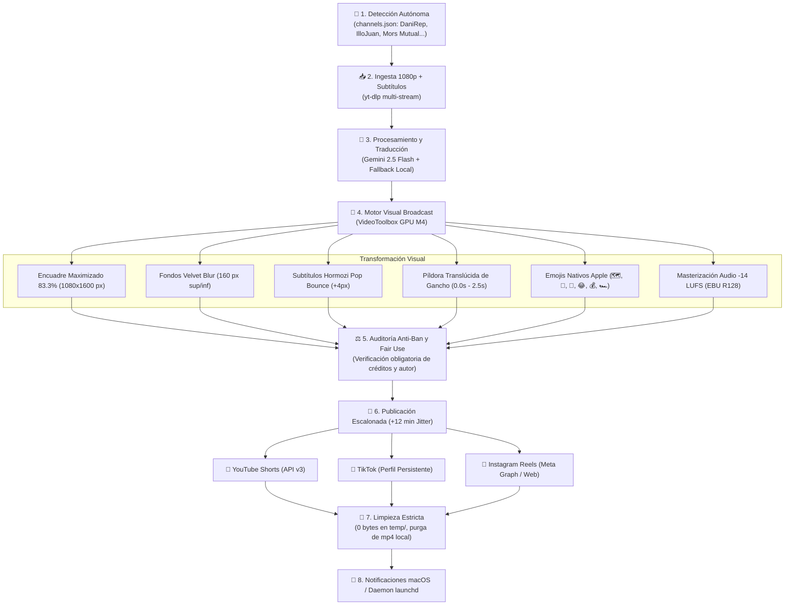

<p align="center">
  
</p>

<p align="center">
  
  
  
  
  
</p>

# 🎮 GTA VI Hub Spain — Autonomous Content Engine (macOS M4)

Pipeline de producción y distribución audiovisual 100% autónomo para **YouTube Shorts, TikTok e Instagram Reels**, optimizado para ejecutarse silenciosamente en segundo plano en **Apple Silicon (M1/M2/M3/M4)** con aceleración por hardware nativa (`h264_videotoolbox`).

---

### 🌐 Canales y Redes Sociales Oficiales

| Plataforma | Canal Oficial | Identidad Visual | Estado |
| :--- | :--- | :---: | :---: |
| 🔴 **YouTube Shorts** | [**GTA VI Hub Spain**](https://www.youtube.com/channel/UCBOl2KuaHEoUWYWJqb7ID9Q) | Avatar Neón + Portada 4K | **Conectado (OAuth2 API v3)** |
| 📸 **Instagram Reels** | [**@gtavihubspain**](https://www.instagram.com/gtavihubspain/) | Avatar Neón + Bio Oficial | **Activo y Verificado** |
| 🎵 **TikTok** | [**@gtavihubspain**](https://www.tiktok.com/@gtavihubspain) | Avatar Neón + Bio Oficial | **Activo y Verificado** |

---

## 🏗️ Arquitectura del Sistema



---

## ⚡ Estándares Broadcast y Retención Móvil

1. **Reencuadre Cinematográfico al 83.3% (`1080x1600 px`):**
   * El clip horizontal 16:9 se amplía recortando laterales para centrar al streamer o la jugabilidad.
   * Franjas superior e inferior con desenfoque aterciopelado (*velvet blur*) de solo 160 px, integradas con sombras de profundidad multinivel.
2. **Subtítulos Dinámicos Alex Hormozi (Pop Bounce):**
   * La palabra activa **aumenta de escala dinámicamente (`+4px`)**, iluminándose en amarillo eléctrico o rosa neón con halo de lectura.
   * Filtro de *rolling buffer* para evitar solapamientos y anclaje en `y=1280` (zona segura sobre los botones de TikTok/Reels).
3. **Píldora Flotante de Gancho Superior (`0.0s a 2.5s`):**
   * Titular en cristal oscuro translúcido que retiene la atención inicial y se desvanece de forma suave.
4. **Blindaje de Derechos de Autor (Fair Use):**
   * Inyección obligatoria de créditos reales (`@CreadorOriginal`), enlace URL directo a la fuente y descargo estatutario bajo el **Artículo 107 de la Copyright Act de 1976**.

---

## 🚀 Guía de Comandos Rápidos (`run.sh`)

```bash
# 1. Panel de control y monitorización en tiempo real
./run.sh status

# 2. Auditar cumplimiento de políticas de YouTube, TikTok y Meta
./run.sh audit

# 3. Simular publicación completa multiplataforma (Sandbox seguro)
./run.sh --url "<ENLACE_YOUTUBE>" --publish-all --dry-run

# 4. Procesar un vídeo y abrirlo inmediatamente en QuickTime Player
./run.sh --url "<ENLACE_YOUTUBE>" --preview

# 5. Ejecutar escaneo autónomo de canales (channels.json)
./run.sh --auto

# 6. Forzar purga y limpieza de residuos en disco
./run.sh --clean
```

---

## 🖥️ Operación Desatendida 24/7 en macOS (`launchd`)

Para dejar el motor funcionando de forma continua en tu **MacBook Pro** como servidor headless:

1. **Instalar el demonio de automatización:**
   ```bash
   cp assets/com.gtavihub.automation.plist ~/Library/LaunchAgents/
   launchctl load ~/Library/LaunchAgents/com.gtavihub.automation.plist
   ```
2. **Horarios de ejecución automática (Horas punta España):**
   * 🕑 **14:00** (Hora punta de almuerzo).
   * 🕖 **19:30** (Hora punta gaming de tarde).
3. **Desactivar el servicio:**
   ```bash
   launchctl unload ~/Library/LaunchAgents/com.gtavihub.automation.plist
   ```

---

## 📚 Documentación de Referencia

* [**Guía de Uso Exhaustiva (`GUIA_DE_USO.md`)**](./GUIA_DE_USO.md): Manual paso a paso, instalación, configuración de OAuth2 y credenciales.
* [**Directrices de Calidad y Anti-Ban (`DIRECTRICES.md`)**](./DIRECTRICES.md): Protocolos de seguridad algorítmica, límites diarios y prevención de strikes.
* [**Lista de Canales Monitorizados (`channels.json`)**](./channels.json): Canales oficiales y creadores configurados.
